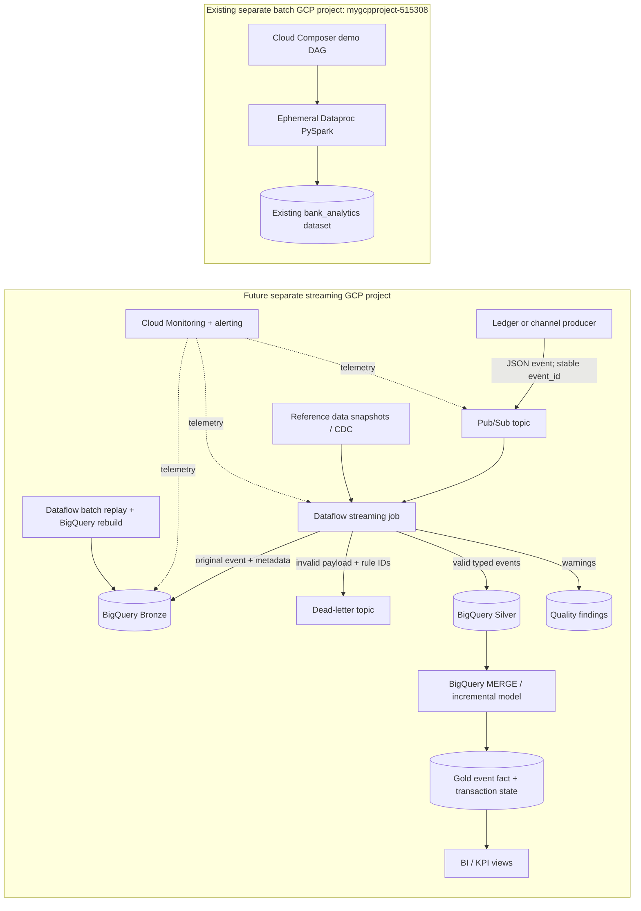

# Near-real-time banking analytics design

## Purpose and scope

This is the later-phase target design, based on a fictional retail bank and synthetic records. It removes dependence on BankEvalDB and is deliberately isolated from the batch pipeline. The business contract is in `config/production_event_contract.json`, the JSON Schema is `config/schemas/transaction_event_v1.schema.json`, and example events are in `data/realtime/sample_transaction_events.jsonl`.

**Phase order:** finish and validate the batch pipeline first. Do not create the separate streaming GCP project or deploy Pub/Sub/Dataflow until the batch release gate is complete. The existing batch project is `mygcpproject-515308`; the streaming project ID is a future, separately created project and is not provisioned yet.

This document makes the product assumptions explicit so the pipeline can be built and verified without access to a real bank's files. The synthetic rule thresholds are test fixtures, not approved financial controls, fraud criteria, AML advice, or regulatory policy. The proposed freshness goals are targets to test, not measured service guarantees.

## The runtime flow

### What runs continuously

1. A producer publishes one immutable JSON transaction event per Pub/Sub message. It uses a stable `source_system` + `source_event_id` across retries and supplies a monotonically increasing sequence for a transaction lifecycle.
2. Pub/Sub buffers and redelivers events. Delivery is treated as at least once; consumers must deduplicate. Cloud Storage notifications can trigger file-based feeds, but those notifications are also at-least-once and have no delivery-time SLA. A file adapter should validate a completion manifest and publish each record into the same event contract.
3. A continuously running Dataflow streaming job parses and validates messages, preserves raw payload and source metadata in Bronze, routes hard failures to a dead-letter path, and writes accepted events to Silver. Dataflow uses the BigQuery Storage Write API. The design still deduplicates on the stable source event key; transport-level exactly-once is not the same as business-level idempotency.
4. A small incremental BigQuery model applies POSTED, REVERSED, and ADJUSTED events to the transaction state and updates KPI tables/views. Event history remains append-only. Reversals and corrections are new facts; they do not erase the original event.
5. The future streaming project uses only its own Dataflow streaming and batch jobs, BigQuery, Pub/Sub, service identities, monitoring, and billing. The existing Composer/Dataproc batch project remains isolated: no shared datasets, buckets, service accounts, or backfill jobs. Finish the batch pipeline before beginning this phase.
6. Monitoring tracks event age, Pub/Sub backlog, Dataflow system lag/errors, DLQ count, accepted/rejected counts, BigQuery job errors, freshness, and cost. Alerts go to the team's chosen incident channel after that integration is configured.

Cloud Storage notifications are at-least-once, can be out of order, and have no notification delivery-time SLA. Pub/Sub should therefore notify a file-ingest adapter, while the adapter uses object generation/checksum and a producer-written manifest to ensure a complete immutable file is read exactly once at the application level. See the Google Cloud [Cloud Storage Pub/Sub notifications documentation](https://docs.cloud.google.com/storage/docs/pubsub-notifications?hl=en).

Dataflow's Pub/Sub connector has deduplication behavior and streaming modes; the project should choose exactly-once mode for business aggregations and still deduplicate by its own stable event key. The BigQuery streaming sink should use the Storage Write API. See Google's [Dataflow Pub/Sub guide](https://docs.cloud.google.com/dataflow/docs/concepts/streaming-with-cloud-pubsub), [streaming modes](https://docs.cloud.google.com/dataflow/docs/guides/streaming-modes), and [BigQuery sink guide](https://docs.cloud.google.com/dataflow/docs/guides/write-to-bigquery).

## Contract, identifiers, and data model

The JSON file is the machine-readable contract. In short:

| Data | Type / key | Purpose |
|---|---|---|
| `event_id` | UUID | Immutable event ID from the producer; use it for lineage and traceability. |
| `(source_system, source_event_id)` | Composite unique key | Idempotency key across producer retries and duplicate deliveries. |
| `transaction_id` | Business key | Groups the original posting and its reversal/adjustments into one transaction lifecycle. |
| `source_sequence` | 64-bit integer | Orders lifecycle events from a source; detect gaps and stale duplicates. |
| `event_time`, `published_at` | UTC RFC3339 timestamps | Business time and source publication time; retain both. |
| `amount_minor` | Signed 64-bit integer | Avoid floating point rounding; the sign must agree with `direction`. |
| `currency` | Three-letter uppercase code | Currency is part of monetary meaning. Convert only with a separately versioned FX source and rate timestamp. |
| `account_id`, `customer_id` | Business foreign keys | Resolve account ownership as effective at `event_time`, not just current state. |
| `lineage_id` | UUIDv5 | Deterministic internal trace ID derived from source system and source event ID. |
| `run_id` | UUIDv5 per processing window | Connects output rows, quality findings, and audit rows to one processing window. |

Reference data uses `customer_id` and `account_id` as business keys. Customer and account attributes use SCD Type 2 effective intervals (`effective_from`, exclusive `effective_to`, and current flag); validate exactly one matching version for each event's `event_time`. Account must belong to the supplied customer. Missing reference data is quarantined or held for bounded reprocessing, never silently dropped.

`POSTED` creates the initial signed amount. `REVERSED` is a new event on the same `transaction_id`, references the original transaction, uses the same currency, and exactly negates the posting. `ADJUSTED` is a new signed delta linked to the original; the reducer applies it in source sequence. A transaction's current net is calculated only within one currency. Cross-currency conversion requires a separate approved FX feed, rate timestamp, and reporting-currency rule.

### Proposed BigQuery tables

| Dataset/table | Write pattern | Purpose |
|---|---|---|
| `bronze.transaction_events` | Append only, ingestion-date partition | Original JSON payload, Pub/Sub IDs/attributes, object generation if file-originated, event ID, lineage ID, run ID, received timestamp. |
| `silver.transaction_events` | Idempotent `MERGE` on source event key | Typed, validated event rows and reference keys. Keep event-time partitioning and cluster by account/transaction IDs. |
| `quality.quarantine_events` | Append, idempotent by source event key + rule ID | Original payload, stable rejection reason, rule version, retry/release state. |
| `quality.findings` | Idempotent by source event key + rule ID + rule version | Non-blocking synthetic anomalies with severity and evidence. |
| `gold.fact_transaction_event` | Append-only event fact | One row per accepted lifecycle event, with dimensional keys and lineage. |
| `gold.transaction_current_state` | `MERGE` by transaction ID | Current net state derived from ordered event history; corrections can be replayed deterministically. |
| `ops.pipeline_runs` | Append run/window audit | Contract version, code version, input/output counts, lag, status, and run ID. |

Partition tables by ingestion date for Bronze and event date for Silver/Gold, with an explicit retention policy chosen by the data owner. Use clustering on join/dedup keys. Production retention values are intentionally unset until approved.

## Synthetic business rules

The complete rule list and values live in `config/production_event_contract.json`. Hard failures are quarantined with rule IDs. Warnings create reviewable findings and do not alter or block a customer's transaction. Demonstration assumptions include an allowed currency list of GBP/USD/EUR, a synthetic event amount cap, a synthetic high-value observation, and a near-threshold activity heuristic. These numbers exist only to exercise validation and observability. They are not real bank limits, AML thresholds, fraud rules, or customer actions.

Productionization of this synthetic contract still requires domain sign-off for currencies, amount bounds, event semantics, reference-data freshness, reversals, adjustments, ordering, retention, and permitted analytics. The project can test technical behavior with generated fixtures without claiming those decisions are bank-approved.

## Reliability and recovery

- **Duplicate messages:** retain the original delivery in Bronze; Silver and Gold are idempotent on stable business/source event keys. A repeated `event_id` with different payload hash is a producer integrity incident and is quarantined.
- **Out-of-order events:** use source sequence and event time. Preserve all arrivals. Apply the 15-minute watermark for operational windows, but late events remain eligible for correction/recomputation; the watermark is not a discard rule.
- **Missing reference:** quarantine/hold with retryable state, refresh reference data, then replay only affected events by lineage/source key.
- **Bad message:** persist payload and failure rule in DLQ/quarantine; alert on the first event and sustained count. Do not retry permanent schema failures forever.
- **Worker or sink outage:** Pub/Sub retains backlog per configured retention; Dataflow resumes from checkpoints; watch oldest message age and capacity. Size retention and dead-letter replay controls before a real SLA.
- **Partial publication:** Bronze append is the durable intake record. Silver and current-state merges are independently idempotent and use a run/window audit. Mark a window complete only after count reconciliation and checks pass.
- **Backfill:** A later streaming-project Dataflow batch job and BigQuery model replay an immutable input manifest and bounded date/key range. They write to staging, compare counts/checksums, and publish with approved merge/rollback steps. The batch project is not used. Never run the old Day 0 full-refresh DAG against production tables.

## Security and operations

Use separate dev/test/prod projects or datasets, least-privilege runtime service accounts, private networking where required, CMEK only if selected by the security owner, Secret Manager for secrets, audit logs, no service-account keys, restricted BigQuery authorized views, and approved masking/tokenization for personal data. Public source/temp buckets are prohibited. Configure object versioning/retention, data deletion, legal hold, and backup policy only with the data governance owner.

Proposed test objectives in the contract are p95 event-to-Gold freshness under 120 seconds and p99 under 300 seconds for a small synthetic workload. Load test at expected and burst volumes; measure cost, backlog recovery, duplicates, late arrivals, reference lag, and BigQuery slots before declaring an SLO. Alert when oldest-message age exceeds 300 seconds, DLQ count is non-zero, job errors persist, or freshness/cost thresholds are exceeded. These are initial targets, not measured performance.

## Build and release plan

1. **Contract tests:** validate every field/type/enumeration and generated valid/invalid fixture against the JSON contract; test duplicate, conflict, reversal, adjustment, missing reference, out-of-order, and late events.
2. **Implement Dataflow:** source Pub/Sub, contract validation, stable-key deduplication, raw Bronze, accepted Silver, dead-letter, findings, metrics, and Dataflow autoscaling bounds. Pin SDK/runtime versions and template artifact by immutable digest.
3. **Implement BigQuery models:** idempotent event-level merge; deterministic transaction-state reducer; event-time SCD2 reference joins; audit and count reconciliation. Verify repeat runs yield the same result.
4. **Later, after batch sign-off, provision with IaC:** create a separate GCP project with separate billing, Pub/Sub topics/subscriptions/DLQ, Dataflow service identity/network, BigQuery dataset/tables, IAM, monitoring, and alert policies. Do not run the batch `deploy.sh` for streaming.
5. **Run synthetic load tests:** replay `data/realtime/sample_transaction_events.jsonl`, then generate at least expected peak and 2x burst volumes. Test restart, sink outage, Pub/Sub redelivery, duplicate source IDs, schema evolution, late data, DLQ replay, and rollback.
6. **Release:** protected branch, reviewed contract/code changes, CI, pinned artifacts, dev -> test -> production promotion, schema compatibility policy, canary, rollback, and named on-call owner.
7. **Promote only after evidence:** deployment isn't complete until dashboards, alert delivery, replay drills, recovery time, cost, access review, and data governance approvals are recorded.

## Current implementation status

This design and synthetic contract are in the repository for the later phase. The existing `bank_customer_pipeline` DAG and `spark/pipeline.py` are still the Day 0/1/2 batch demo; they do not implement the Pub/Sub/Dataflow runtime above. Complete and validate the batch release first. No streaming job, production BigQuery event tables, infrastructure-as-code, alert integrations, or measured SLO has been deployed by this design document. Do not call the project production-ready until the build plan is implemented, tested, and run in the target GCP environment.

