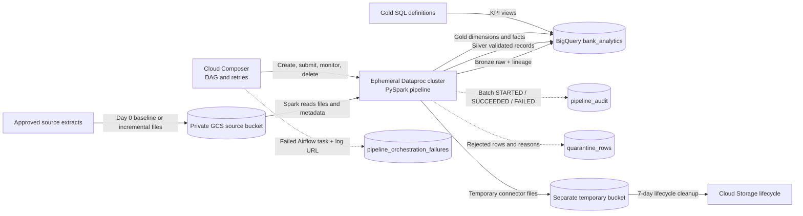
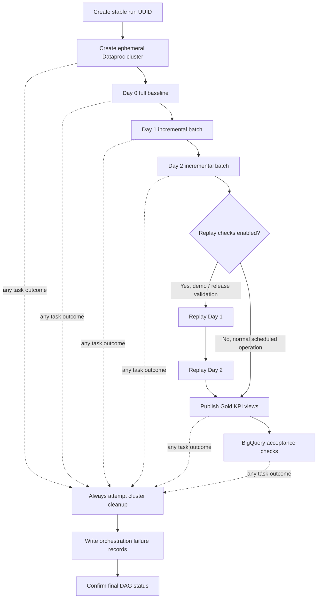

# Bank Analytics Pipeline Operations Runbook

## Purpose and production status

This guide explains the GCS, Cloud Composer, Dataproc, and BigQuery path, how to deploy and operate it, and how to find a failed record or run. The code now assigns stable UUIDs to runs and source rows, logs Composer task failures to BigQuery, supports retries and timeouts, and keeps replay checks optional. The previously successful Composer execution used the earlier demo version; these hardening changes still need a controlled deployment and end-to-end rerun.

The workflow is a batch demo, not a production release. Its repository-owned contract is synthetic, and table publication still uses full-table overwrites rather than an atomic staging-and-swap process. Spark now parses records on executors instead of collecting source rows on the driver, with a 64 MiB source-object cap. Each whole object is still read by one Spark task, so high-volume inputs must be sharded and performance-tested. The fixed Day 0/1/2 workflow and recovery semantics must be replaced or isolated before recurring production use.

For the proposed continuous near-real-time design using a self-defined fictional bank contract, see [near_real_time_production_design.md](near_real_time_production_design.md), [the contract](../config/production_event_contract.json), and [its JSON Schema](../config/schemas/transaction_event_v1.schema.json). That target contract does not rely on BankEvalDB. It is a design and synthetic test specification; the live streaming runtime has not been implemented or deployed. This runbook below describes the existing Composer/Dataproc batch demo.

## Architecture

Composer coordinates the work and tracks task outcomes. Dataproc reads the source and runs PySpark. BigQuery stores the medallion tables and serves the analytical views. The temporary bucket is separate from the source bucket and has a seven-day cleanup rule.

## Pipeline execution graph

The current DAG always processes the three named demo prefixes. Do not attach a recurring production schedule to this demo DAG: each run starts with a Day 0 full refresh. Production incremental scheduling needs a separately configured batch manifest/prefix and a run mode that never replays the baseline.

## Run and record identifiers

| Identifier | Meaning | Stability |
|---|---|---|
| `run_id` | UUIDv5 derived from the Airflow DAG ID and Airflow run ID | Same for a retry of the same DAG run; new for a distinct Airflow run |
| `lineage_id` | UUIDv5 derived from source URI, physical record number, and deterministic row hash | Same when the same source row is replayed; changes when its content, path, or source position changes |
| `_row_hash` | SHA-256 of entity and business-field content | Identifies equal business content independent of run |
| `_batch_id` | Logical input group such as `day0`, `day1`, or `day2` | Identifies which batch a row belongs to |

`run_id` and `lineage_id` are carried into Bronze/Silver, accepted transaction facts, quarantine records, findings, and batch audit records where applicable. The orchestration failure table also stores the Airflow run ID, task, state, error summary, and log URL. Keep the source URI and source record number for exact source tracing.

## Data contract and table map

Inputs are UTF-8 text files with interleaved `#ENTITY:<name>` blocks and pipe-delimited headers and rows. Quoted fields use double quotes. Entity names, columns, keys, types, references, and validation settings are in `config/entities.json`.

| Layer | Main tables | Purpose |
|---|---|---|
| Bronze | `bronze_customers`, `bronze_accounts`, `bronze_transactions`, and related entity tables | Raw source fields, source URI/record number, batch/run/lineage identifiers, and row hash |
| Silver | `silver_customers`, `silver_accounts`, `silver_transactions`, and related entity tables | Cast and validated business records; current and historical SCD2 rows for customers/accounts |
| Gold | `dim_customer`, `dim_account`, `dim_branch`, `dim_account_type`, `dim_product`, `dim_transaction_type`, `dim_date`, `fact_transaction` | Star schema for reporting, temporal dimension resolution, and one accepted row per transaction |
| Operations | `pipeline_audit`, `pipeline_orchestration_failures`, `metadata_entity_config`, `metadata_validation_rules` | Run status, failed Composer tasks, and active metadata |
| Data quality | `quarantine_rows`, `data_quality_findings`, `data_quality_summary` | Rejected records and reasons, warning-level flags, and grouped counts |
| Analytics | `kpi_*` views | Customer, product, branch, transaction, loan, card, SCD2, and data-quality views |

Day 0 is a full baseline. Day 1 and Day 2 are incremental input batches in the demo. Replays are disabled by default; set the Composer Variable `BANK_ENABLE_REPLAY_CHECKS=true` for a demo or release-validation run. Set it to false for normal processing.

## Deployment steps

1. **Confirm project and data approvals.** Choose the billing project, region, source bucket, separate temp bucket, BigQuery dataset, Composer size, and a tested Composer image version. Confirm retention, CMEK, VPC Service Controls/private IP, IAM, and data classification with the cloud/security owner.
2. **Validate the repository-owned input contract.** Check the generated batch files against `config/entities.json`, including types, business keys, references, effective-date behavior, and the explicitly synthetic rule values. No BankEvalDB file, schema, key, or threshold is required for this project. Any later live-bank use needs separate owner approval of the contract and rules.
3. **Authenticate without service-account keys.** Use an approved Google Cloud identity through Workload Identity/ADC. The bootstrap creates service accounts but does not generate keys.
4. **Set deployment variables.** In Bash or Cloud Shell, set `PROJECT_ID`, `REGION`, `BUCKET`, `TEMP_BUCKET`, `DATASET`, `COMPOSER_ENV`, `COMPOSER_ENV_SIZE`, and a tested immutable `COMPOSER_IMAGE_VERSION`.
5. **Run the bootstrap.** From the project directory, run `bash deploy.sh`. It enables APIs, creates missing service accounts/buckets/dataset/environment, scopes data access to resources, configures temp-object lifecycle cleanup, migrates `pipeline_audit.run_id` when the table already exists, uploads the PySpark source/config, and uploads the DAG/SQL to Composer.
6. **Set Composer Airflow Variables.** Configure `BANK_PROJECT_ID`, `BANK_REGION`, `BANK_BUCKET`, `BANK_TEMP_BUCKET`, `BANK_DATASET`, `BANK_PIPELINE_SA`, `BANK_MAX_ACTIVE_RUNS=1`, `BANK_ENABLE_REPLAY_CHECKS=false`, and `BANK_SCHEDULE` only after the production batch-ingestion mode is implemented. Leave `BANK_SCHEDULE` unset for the current demo DAG.
7. **Load approved source files.** Upload an approved baseline and incremental extracts to the agreed GCS prefixes. A production source feed should publish a completion manifest/ready marker only after every object is present and checksummed.
8. **Confirm DAG import.** In Airflow, confirm `bank_customer_pipeline` parses without import errors. Confirm the task graph and the resolved resource variables before triggering.
9. **Trigger release validation.** Use synthetic or masked data in a nonproduction project. Enable replay checks, execute baseline/incremental/replay, and inspect task logs, audit rows, quarantine examples, findings, Gold dimensions/facts, and each KPI view.
10. **Release through version control.** Review the Git diff, use a protected branch and pull request, require peer/security review, deploy the exact reviewed commit, and record the commit SHA in the run/change record.
11. **Monitor and alert.** Alert on failed DAG runs, missing ready markers, late batches, high quarantine rates, unexpected zero-row output, unexpected KPI shifts, and Dataproc cleanup failures. Cloud Logging and Airflow logs remain the fallback if BigQuery failure-audit writes are unavailable.

## Failure handling and recovery

| Failure | Where to inspect | Recovery |
|---|---|---|
| Malformed or invalid source row | `quarantine_rows` (`_dq_reason`, `_source_uri`, `_source_record_number`, `lineage_id`) | Correct source/config, preserve the failed record, and rerun the same immutable batch |
| Warning-level transaction/anomaly | `data_quality_findings` with `lineage_id` and `run_id` | Review under approved policy; do not automatically label as fraud |
| Spark/job failure | `pipeline_audit` with `status=FAILED`, `run_id`, `error_type`, `error_message`; Dataproc job logs | Fix cause, then replay only after assessing partial writes; current overwrite model requires care |
| Composer task or BigQuery acceptance failure | `pipeline_orchestration_failures`, Airflow task log URL, Airflow state | Resolve the cause and rerun under a new Airflow run; inspect downstream tables before rerun |
| Cluster teardown failure | Airflow cleanup task and Dataproc cluster state | Manually remove the named ephemeral cluster; the one-hour auto-delete TTL is a backstop |
| Duplicate source delivery | `lineage_id`, `_row_hash`, bronze uniqueness checks | Verify source identity and rerun only after confirming stable URI/content and deduplication behavior |
| Changed transaction ID reused by a source | `quarantine_rows` with `transaction_business_key_conflict` | Preserve the original transaction fact; reconcile with the source owner and send approved corrections as a separately defined event/change |
| Out-of-order customer/account effective date | `quarantine_rows` with `scd2_out_of_order_effective_at` | Preserve current SCD intervals; run a reviewed bounded correction/backfill after confirming effective-time semantics |

Do not truncate or overwrite production tables during manual recovery. Preserve the failed batch and audit trail, then use a reviewed replay/backfill procedure. The current demo pipeline writes full table snapshots and needs a staged atomic publication design before high-availability production use.

## Production gates before live bank data

- Keep input objects below the 64 MiB cap and shard the data to provide Spark parallelism. The current interleaved text format is parsed one complete object per Spark task; benchmark expected peak sizes and migrate to splittable entity files if needed.
- Write to run-specific BigQuery staging tables, validate staged output, then publish with atomic `MERGE`/transactions or table swaps. Avoid partial publication and destructive overwrites on a task retry.
- Build a manifest-driven incremental DAG with an explicit baseline workflow, readiness marker, immutable batch ID, checksums, late-arrival policy, and backfill controls. The current fixed Day 0/1/2 DAG is a demo workflow.
- Out-of-order SCD2 updates are quarantined as `scd2_out_of_order_effective_at` to avoid invalid intervals. Define and implement a controlled correction/backfill procedure before accepting late corrections.
- Validate every threshold and rule against approved source records and business owners; alerting and false-positive review need an operational owner.
- Apply approved encryption keys, network isolation, private access, audit logging, retention/deletion policy, row/column security, and separate environments for dev/test/prod.
- Add automated unit/integration tests, data-contract checks, deployment rollback, CI, protected Git branches, code owners, and incident runbooks. This hardening update has not yet been deployed or run in Composer.

## Current verified state

The previous demo run `manual__hackathon_demo_20261120_1740` succeeded with baseline, both increments, replays, KPI publication, acceptance, cluster cleanup, and final status. That run predates the UUID/lineage fields, centralized Composer failure log, generalized acceptance checks, optional replay gate, and revised IAM bootstrap. Those newer changes must be reviewed and rerun in a nonproduction Composer environment before they are treated as validated.

